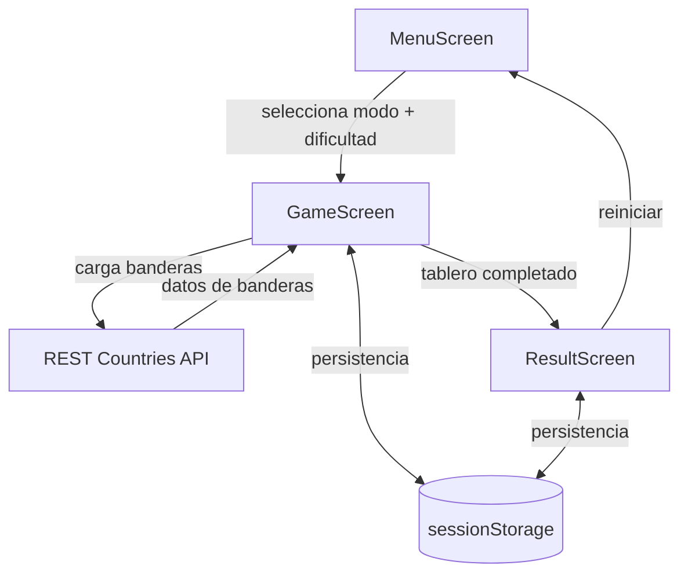
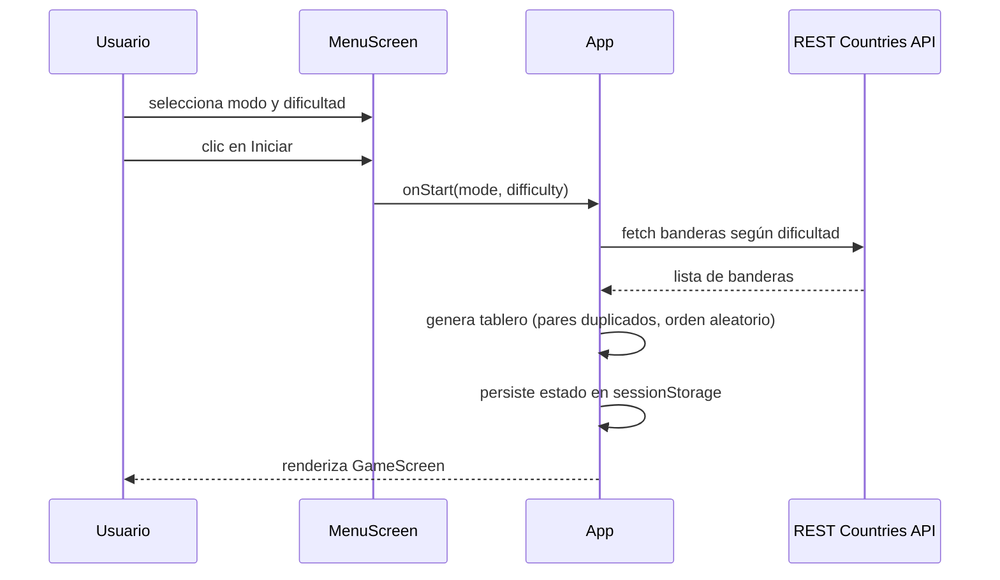
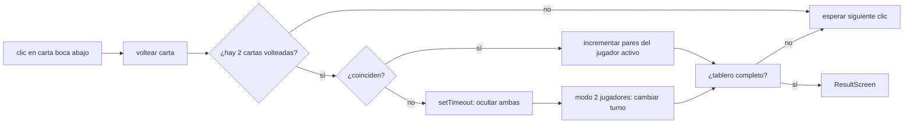

# Documento de Diseño

## Resumen

Aplicación SPA construida con React + Vite, estilizada con Tailwind CSS y animada con Framer Motion. Se compone de tres pantallas principales (menú, tablero, resultado) gobernadas por un único estado de partida persistido en `sessionStorage`. Las banderas provienen de REST Countries API mediante `fetch()`. La celebración final usa canvas-confetti.

## Arquitectura



La app es un único árbol de componentes React sin routing (el cambio de pantalla se maneja con un campo `screen` en el estado global). No se usa Redux ni Context API: basta un `useState` elevado en `App.jsx` y props hacia abajo, dado el tamaño del MVP.

## Componentes

| Componente | Responsabilidad |
|---|---|
| `App` | Mantiene el estado global de partida y decide qué pantalla renderizar. |
| `MenuScreen` | Selección de modo y dificultad; botón de inicio. Animaciones de entrada con Framer Motion. |
| `GameScreen` | Renderiza tablero, marcador, timer (modo 1 jugador) y maneja la lógica de volteo/comparación/turnos. |
| `Card` | Carta individual con animación de volteo 3D (`rotateY`) mediante Framer Motion. |
| `Scoreboard` | Muestra pares por jugador y resalta el jugador activo en modo 2 jugadores. |
| `ResultScreen` | Marcador final, confeti con canvas-confetti, botón de reinicio. |
| `LoadingState` | Spinner visible mientras se cargan banderas. |
| `ErrorState` | Mensaje de error + botón de reintento si falla la carga. |

## Flujos

### Flujo de inicio de partida



### Flujo de volteo y comparación



## Modelo de Datos

Estado global de partida (`App`):

```ts
type Mode = 'single' | 'versus';
type Difficulty = 'easy' | 'medium' | 'hard';

interface FlagData {
  name: string;
  flag: string; // URL de la imagen
}

interface CardState {
  id: number;
  flag: FlagData;
  isFlipped: boolean;
  isMatched: boolean;
}

interface GameState {
  screen: 'menu' | 'game' | 'result';
  mode: Mode | null;
  difficulty: Difficulty | null;
  cards: CardState[];
  flippedIds: number[];
  currentPlayer: 1 | 2;
  pairsP1: number;
  pairsP2: number;
  elapsedSeconds: number;
}
```

Persistencia: el objeto `GameState` (sin `screen`) se serializa en `sessionStorage` bajo la clave `memoria-banderas-state` en cada cambio relevante. Se limpia al completar la partida o al volver al menú.

## Interfaces e Integraciones

### REST Countries API

- Endpoint: `https://restcountries.com/v3.1/all?fields=name,flags`
- Se solicitan todos los países con solo dos campos para minimizar payload.
- Al recibir la respuesta, el cliente selecciona aleatoriamente `N` banderas (`N = 6 | 8 | 10` según dificultad), duplica cada una para formar pares y mezcla el array.
- Timeout de red: 10 s mediante `AbortController`.
- Caché: las banderas descargadas se guardan en `sessionStorage` bajo `memoria-banderas-flags` para evitar re-fetch durante la misma sesión de navegador.

## Manejo de Errores

| Situación | Respuesta |
|---|---|
| Falla el `fetch` a REST Countries API | Mostrar `ErrorState` con botón "Reintentar". |
| Timeout de red (>10 s) | Abortar petición y mostrar `ErrorState`. |
| Respuesta sin banderas válidas | Mostrar `ErrorState` con mensaje específico. |
| `sessionStorage` corrupto o versión incompatible | Descartar el estado guardado y arrancar en menú. |
| Clic en tercera carta con dos ya volteadas | Ignorar la acción (no se procesa). |
| Clic repetido sobre la misma carta volteada | Ignorar la acción. |

## Seguridad

No se manejan datos sensibles ni autenticación. La única integración externa (REST Countries API) es pública y sin credenciales. No se inyecta HTML desde la API: las banderas se renderizan como `` con URL proveniente de la respuesta, y el nombre se escapa por React automáticamente.

## Observabilidad

Dado el alcance del MVP, la observabilidad se limita a `console.info` en puntos clave: inicio de partida, banderas cargadas, par emparejado, cambio de turno, fin de partida. No se integra servicio de telemetría externo.

## Estrategia de Pruebas

- **Pruebas unitarias (Vitest + React Testing Library):**
  - Lógica de generación de tablero (número de cartas según dificultad, pares correctos, orden aleatorio).
  - Lógica de comparación de pares.
  - Cambio de turno en modo 2 jugadores (solo al fallar).
  - Determinación de ganador / empate.
  - Serialización y restauración del estado en `sessionStorage`.
- **Pruebas de propiedades (fast-check):** ver sección `## Propiedades de Correctitud`.
- **Pruebas manuales de integración:** flujo completo en ambos modos y tres dificultades, incluyendo recarga en medio de partida.

## Decisiones y Alternativas

| Decisión | Alternativa descartada | Razón |
|---|---|---|
| Estado global en `App` con `useState` | Redux / Zustand / Context | MVP pequeño; una sola fuente de verdad es suficiente. |
| Sin routing (campo `screen`) | react-router | No hay URLs compartibles ni navegación profunda. |
| `sessionStorage` para persistencia | `localStorage` | El progreso de una partida no debe sobrevivir al cierre de pestaña. |
| Fetch a REST Countries con caché en sesión | Fetch por partida | Evita llamadas redundantes y acelera reinicios. |
| Framer Motion para todo el movimiento | CSS animations puras | API declarativa, menos código y física de resorte ya resuelta. |
| fast-check para PBT | Hypothesis | El proyecto es JS/TS; fast-check es el estándar en ese ecosistema. |

## Propiedades de Correctitud

### Property 1: Invariante del tablero generado

_For any_ dificultad en `{'easy', 'medium', 'hard'}` y cualquier lista de banderas válida de longitud `>= 10`, la función `buildBoard(flags, difficulty)` genera un tablero con exactamente `2*N` cartas (donde `N = 6 | 8 | 10` según dificultad), cada bandera seleccionada aparece exactamente 2 veces, y todas las banderas del tablero provienen del conjunto de entrada.

**Validates: Requirement 2.1, 2.2, 2.3**

- Generadores requeridos: `fc.constantFrom('easy', 'medium', 'hard')` combinado con `fc.array(flagArbitrary, { minLength: 10, maxLength: 30 })`.
- Oráculos o invariantes: `cards.length === 2*N`; conteo por `flag.name` === 2; conjunto de `flag.name` en el tablero ⊆ conjunto de entrada.
- Casos que deben excluirse: listas de banderas con menos de 10 entradas (no alcanzan para dificultad `hard`).
- Framework propuesto: fast-check (JS/TS) con Vitest.

### Property 2: Invariante de turno en modo versus

_For any_ secuencia de acciones de juego en modo `versus` (acierto o fallo de pares), `currentPlayer` solo cambia de valor cuando la acción fue un fallo; al acertar, `currentPlayer` permanece igual.

**Validates: Requirement 5.2, 5.3**

- Generadores requeridos: `fc.array(fc.boolean())` representando aciertos/fallos, aplicado sobre un reductor puro `applyTurn(state, wasMatch)`.
- Oráculos o invariantes: `wasMatch === true` ⇒ `next.currentPlayer === prev.currentPlayer`; `wasMatch === false` ⇒ `next.currentPlayer === (prev.currentPlayer === 1 ? 2 : 1)`.
- Casos que deben excluirse: estados con `mode === 'single'` (allí no hay turnos).
- Framework propuesto: fast-check con Vitest.

### Property 3: Conservación de pares

_For any_ estado de partida válido y cualquier acción que incremente pares, `pairsP1 + pairsP2` nunca excede el número total de pares del tablero; y cuando todas las cartas están `isMatched === true`, `pairsP1 + pairsP2` es exactamente igual al número total de pares.

**Validates: Requirement 5.3, 6.2**

- Generadores requeridos: `fc.integer({ min: 0, max: totalPairs })` para `pairsP1` y `pairsP2` acotados de forma que la suma sea coherente, más `fc.array(cardArbitrary)`.
- Oráculos o invariantes: `pairsP1 + pairsP2 <= totalPairs`; si `cards.every(c => c.isMatched)` entonces `pairsP1 + pairsP2 === totalPairs`.
- Casos que deben excluirse: tableros con pares incompletos por corrupción (no representan estados alcanzables).
- Framework propuesto: fast-check con Vitest.

### Property 4: Round-trip de persistencia

_For any_ estado de partida persistible (sin `screen`), `loadState(saveState(state))` devuelve un objeto estructuralmente idéntico al original: mismo `cards` (mismo orden, mismo `id`, mismo `flag.name`), mismo `currentPlayer`, mismos `pairsP1`/`pairsP2`, mismo `elapsedSeconds`.

**Validates: Requirement 7.1, 7.2**

- Generadores requeridos: `fc.record` arbitrario que produzca `GameState` válidos (con `cards`, `currentPlayer`, `pairsP1`, `pairsP2`, `elapsedSeconds`).
- Oráculos o invariantes: deep equal entre `state` y `loadState(saveState(state))`.
- Casos que deben excluirse: estados con `screen` (no se persisten) y estados con JSON no serializable.
- Framework propuesto: fast-check con Vitest, usando un `sessionStorage` mock en memoria.

### Property 5: Nunca-crash en comparación de pares

_For any_ par de `CardState` (incluyendo cartas ya emparejadas, ya volteadas, con la misma bandera o con banderas distintas), la función `arePair(a, b)` no lanza excepción y devuelve un booleano.

**Validates: Requirement 4.1, 4.2, 4.3**

- Generadores requeridos: `fc.record` para `CardState` con `id` arbitrario, `flag` arbitrario, `isFlipped` booleano, `isMatched` booleano.
- Oráculos o invariantes: `typeof arePair(a, b) === 'boolean'`; ninguna excepción capturada.
- Casos que deben excluirse: ninguno; la propiedad debe valer para cualquier entrada.
- Framework propuesto: fast-check con Vitest.

## Trazabilidad con Requisitos

| Requisito | Componentes / Módulos implicados |
|---|---|
| 1.1 | `MenuScreen`, animaciones Framer Motion |
| 1.2 | `App`, `MenuScreen`, generación de tablero |
| 1.3 | `App`, `Scoreboard` (inicialización de contadores) |
| 1.4 | `MenuScreen` (botón deshabilitado) |
| 2.1–2.3 | Módulo `loadFlags(difficulty)`, integración REST Countries |
| 2.4 | `LoadingState` |
| 2.5 | `ErrorState`, manejo de fallo de fetch |
| 3.1–3.3 | `Card`, lógica de volteo en `GameScreen` |
| 4.1–4.3 | Lógica de comparación, `setTimeout()` |
| 5.1–5.3 | `Scoreboard`, lógica de turnos en `GameScreen` |
| 6.1–6.3 | `ResultScreen`, canvas-confetti |
| 6.4 | `ResultScreen` (botón reiniciar), limpieza de `sessionStorage` |
| 7.1–7.3 | Persistencia en `sessionStorage`, restauración al montar |
